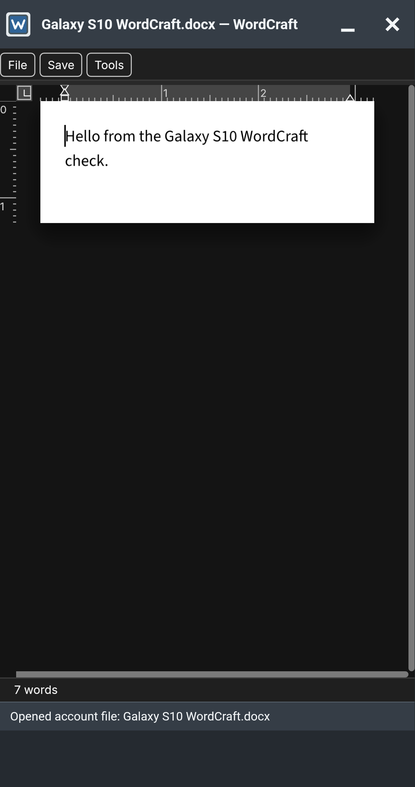
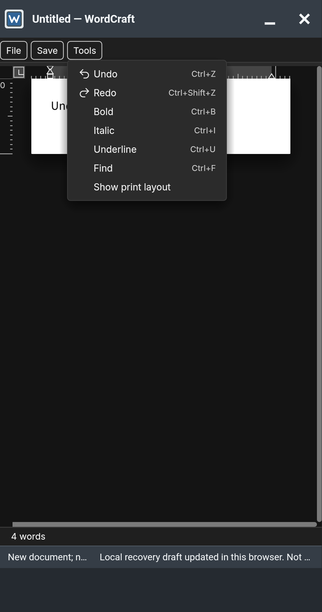
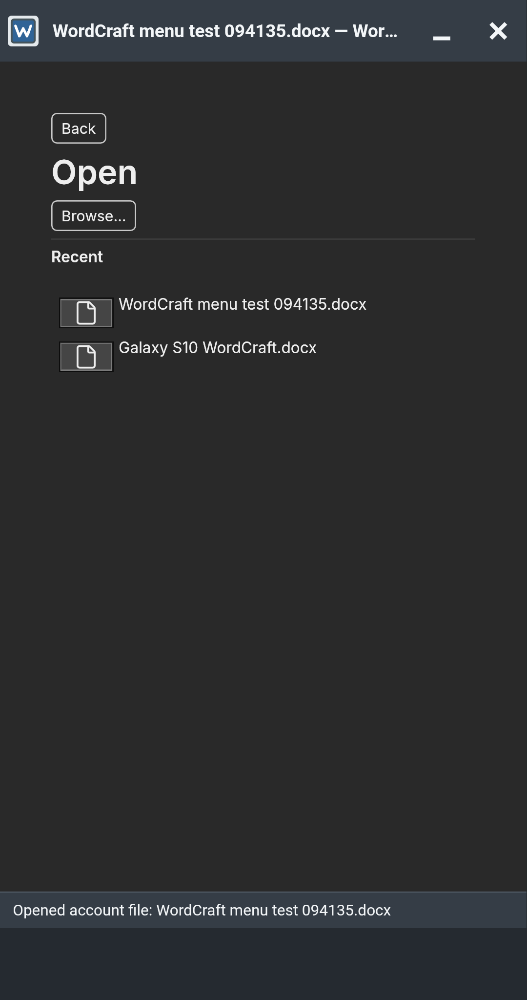

# WordCraft phone workflow

Galaxy S10+ with Chrome 158.0.8127.92 and a 411 CSS-pixel portrait viewport. The private WebOS preview tested WordCraft wrapper source `a61f5c3d` with the `84522b41` browser engine.

1. Launch WordCraft and enter the sample sentence in an editable document.
2. Use Save. The dialog suggests `Documents/Untitled.docx`. Enter `Galaxy S10 WordCraft` to create an editable `.docx`.
3. Close WordCraft and open the saved file from My files. WordCraft launches, retains the file name and shows the original editable text.
4. Dismiss the software keyboard. WordCraft expands to the full available height.

## Compact File and Tools

On the same phone, one tap opened Tools and a second tap ran Undo. In the combined `7c4dcedf` engine, File opened from the editor with the software keyboard visible. **File → Open → Browse** opened the chooser and Cancel preserved the draft. **File → Save As** saved an editable `.docx` from a bare name. My files reopened the document with the original text. File also opened with the keyboard dismissed.

